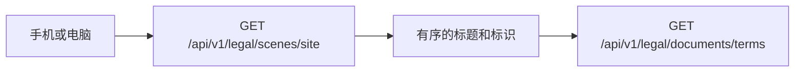

# 条款

条款是稳定的一篇文字，例如使用条款、隐私政策。正文按版本发布，发布之后不能改。改一个字就再发一版。同意是只追加的记录：谁、在什么时候、对哪一版、做了同意、拒绝还是撤回。

手机和电脑请求的是同一组 JSON。服务端不按端画页面，也不看设备。客户端自己把阅读场景画成顶栏或列表，再按条款标识取当前正文。

## 两种阅读

阅读场景把若干已发布条款排好顺序。`site` 是网站顶栏：使用条款在前，隐私政策在后。非活跃账号处理规范不在这个顶栏里，单独用它的标识打开。

同意场景用来勾选，不负责画顶栏。`register` 和 `quick-create` 里，使用条款和非活跃账号处理规范是同一组，一个勾选框两条链接；隐私政策单独一组。两组都必选。注册页还没有接这些接口。

企业版、高校版这类新条款，在管理端建好并挂进 `site`，顶栏就会多一项。不用改接口。

## 公开接口

未登录可以读。

| 请求 | 得到什么 |
| --- | --- |
| `GET /api/v1/legal/scenes/{key}` | 阅读场景返回按顺序排好的条款。同意场景再带勾选组、是否必选、勾选文案。只含启用且已发布的条款 |
| `GET /api/v1/legal/documents/{key}` | 该条款当前已发布的标题、版本号、发布时间和 Markdown |
| `GET /api/v1/legal/documents/{key}/versions/{version}` | 某一已发布或已归档版本，用来核对当时同意的正文 |

当前正文示例：`GET /api/v1/legal/documents/terms`。历史正文示例：`GET /api/v1/legal/documents/terms/versions/1.0.0`。

## 登录后

`GET /api/v1/legal/status` 列出还没接受的实质变更。错别字发布不列在这里。

`POST /api/v1/legal/acceptances` 提交一组动作。每项要有条款标识、版本号和动作（`accept`、`decline`、`withdraw`），并带上场景标识。版本必须是当前已发布版。合同不能撤回。同一人对同一版本的同一动作再提交一次，不会多写一行。

注册接入时，先用「某场景的必选项是否都在这次提交里」核对，再和建用户写在一起。这个核对已经在服务里，注册接口本轮不调用它。也没有拦住全部已登录请求的中间件，避免没有补签页面时进不了后台。

## 管理端

系统管理里的「条款管理」有四个页签：条款、版本、场景、同意记录。同意记录只读，用户显示昵称或账号，点开可以看到账号、条款、版本和动作。已有同意记录的条款不能删，只能停用。已发布的版本不能改。

## 初始数据

| 标识 | 名称 | 性质 |
| --- | --- | --- |
| `terms` | 使用条款 | 合同 |
| `inactive-account` | 非活跃账号处理规范 | 合同 |
| `privacy` | 隐私政策 | 告知 |

三条都发布了 `1.0.0`，变更级别是实质变更。

| 场景 | 用途 | 内容 |
| --- | --- | --- |
| `register` | 同意 | 使用条款与非活跃账号同一组；隐私政策单独一组 |
| `quick-create` | 同意 | 与注册相同 |
| `site` | 阅读 | 使用条款、隐私政策 |
