# 登录与注册

同一个人用密码、手机验证码、邮箱验证码或第三方进入，会话里是同一个用户。第三方第一次出现时不自动建号，停在关联页，由用户绑定已有账号、快速创建或注册。认人之后如果开了双因素认证（2FA），还要动态码或一次性恢复码，才发会话。

短信和邮箱验证码是登录方式。双因素认证只认动态码或一次性恢复码。

账号在系统里唯一。登录按手机号、邮箱或账号查找。昵称只用于显示。

| 图 | 什么时候走 |
| --- | --- |
| [人和钥匙](#人和钥匙) | 看一个用户身上挂着什么 |
| [登录](#登录) | 密码、手机验证码、邮箱验证码 |
| [注册](#注册) | 从登录页新建账号 |
| [第三方回来](#第三方回来) | 授权结束后先分流 |
| [关联页默认栏](#关联页默认栏) | 尚未绑定时停在哪一栏 |
| [绑定已有账号](#绑定已有账号) | 证明已有用户后挂上 |
| [快速创建](#快速创建) | 用这次第三方单独建一个号 |
| [关联页里注册](#关联页里注册) | 注册成功后顺手绑上 |
| [改挂](#改挂) | 这条身份已经属于别人 |
| [登录后再绑定](#登录后再绑定) | 从登录方式页发起 |
| [解绑](#解绑) | 去掉一条第三方 |
| [双因素认证](#双因素认证) | 开启、关闭，以及它挡在哪些门上 |
| [授权票据](#授权票据) | 一次未完成的第三方授权 |

## 人和钥匙

用户是本系统里的人。角色、文章和会话里的用户编号都挂在这里。身份是某一家第三方上的稳定账号，钥匙是提供方加上对方的稳定编号。登录名和邮箱只作展示和预填。微信有 unionid 时用 unionid，否则用 openid。

**图：一个用户，多种进入方式**

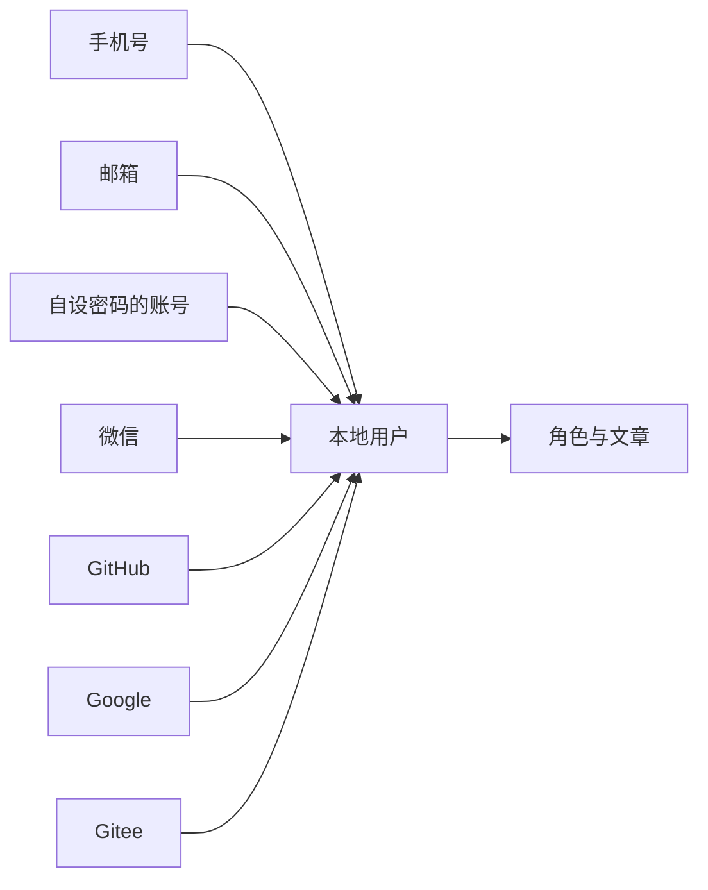

同一用户对同一家第三方只保留一个账号。一个第三方账号全局只属于一个用户。

## 登录

登录页在密码、手机验证码、邮箱验证码之间切换。验证码由本系统发出，要点过获取验证码才接受。

**图：三种登录方式，过了再看双因素认证**

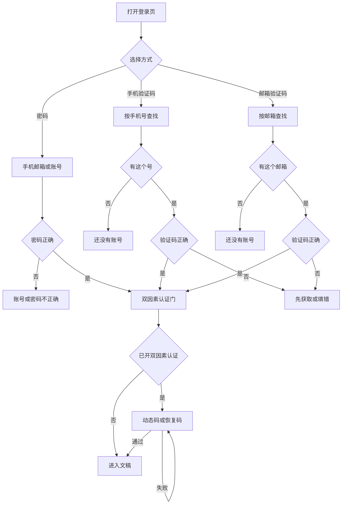

恢复码用过一条就作废。手里还拿着未完成的第三方票据时，认人成功后不直接结束，接着走[绑定已有账号](#绑定已有账号)。

## 注册

注册页在手机号和邮箱之间切换。两边都要本系统发出的验证码，并设置 6 到 64 位的密码。关闭开放注册后不能从这里新建账号。新用户记下这个密码，角色是作者，还没开双因素认证。注册时要勾选的条款不写在这个流程里，见 [条款](legal.md)。当前注册接口还不校验条款。

**图：从登录页注册**

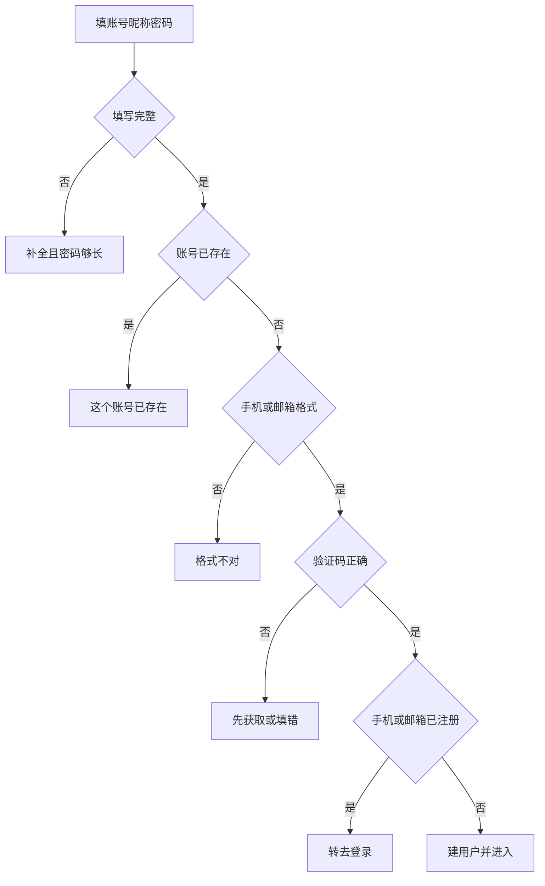

从关联页进来、手机号或邮箱已经有人时，留在关联页并切到绑定，见[关联页里注册](#关联页里注册)。

## 第三方回来

授权只证明用户拿着这个第三方账号。回来后先按「提供方 + 稳定编号」查找，再看当前有没有登录。

**图：授权回来后的分流**

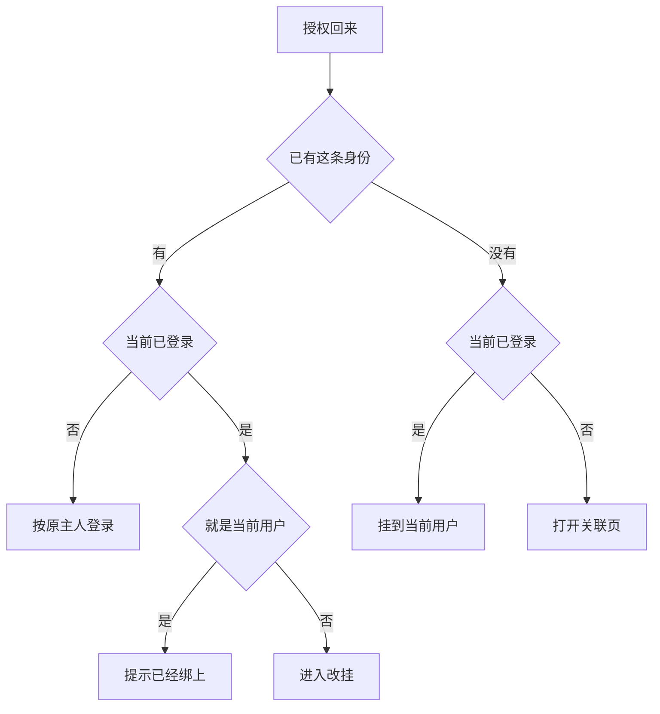

原主人开了双因素认证时，先过动态码或恢复码再进文稿。尚未绑定的，进入关联页，三栏顺序是：绑定已有账号、快速创建、注册新账号。

## 关联页默认栏

默认栏只看第三方带回的、并且声明已验证的手机号或邮箱。对上恰好一个用户就停在绑定并预填，密码或验证码仍然要填。对上多个、未验证，或什么都没带回，就停在注册。快速创建始终放在绑定和注册之间，默认停在绑定或注册。

**图：尚未绑定时默认停在哪一栏**

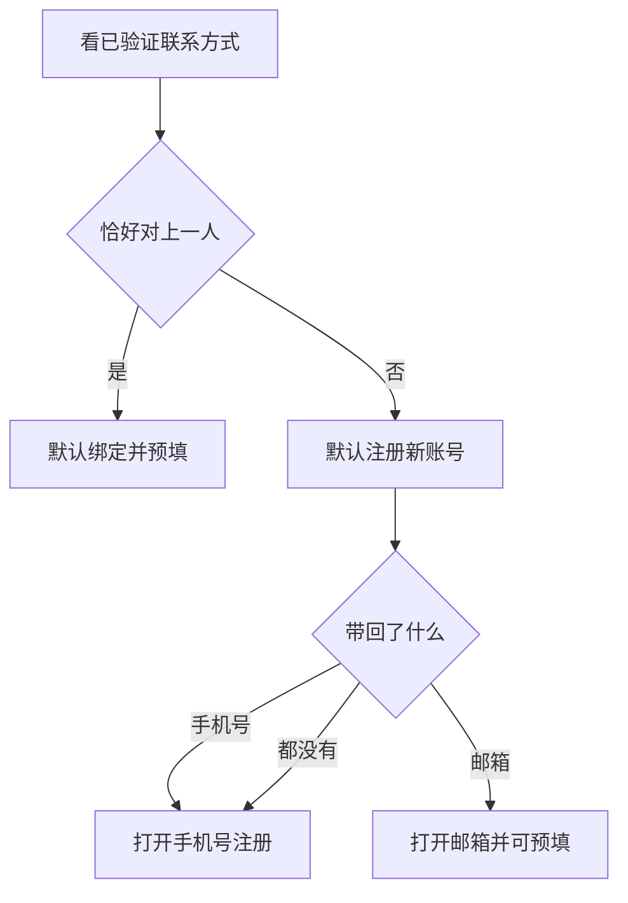

未验证邮箱只出现在注册框里，供用户自己改。微信通常没有邮箱和手机号，默认停在手机号注册。对上多个账号时仍默认注册，用户可以自己改去绑定。

## 绑定已有账号

绑定要证明目标用户：密码，或手机验证码，或邮箱验证码。证明的是谁，就把这次身份挂到谁身上。

**图：证明已有账号后挂上身份**

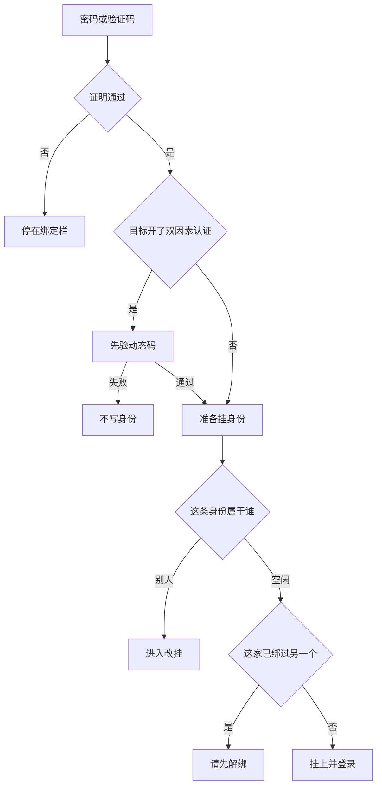

## 快速创建

快速创建用这一次第三方单独建一个账号，并立刻绑上。每个第三方都这样建一次，就会有多个账号。要多种途径进入同一个账号，用绑定已有账号。

新账号的密码用户不知道，所以它不算一种还能回来的登录方式。已验证、且还没人占用的邮箱或手机号会抄到新账号上。已经属于别人的不抄。未验证邮箱不抄。

**图：快速创建一个独立账号**

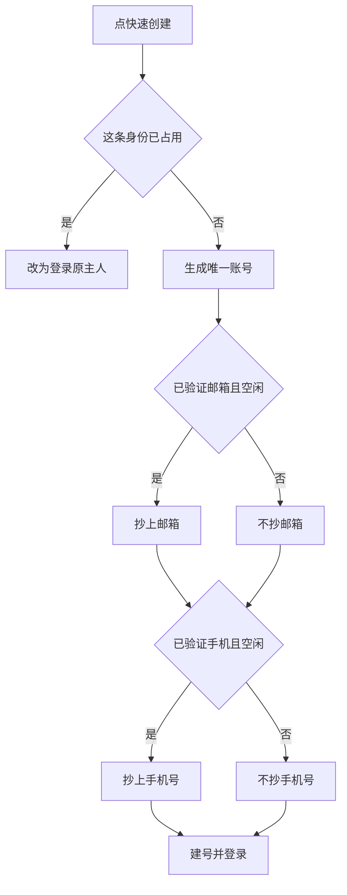

账号名优先用「提供方-登录名」。登录名里没有英文数字时，用「提供方-稳定编号」。和已有账号、手机号、邮箱撞车时，末尾加数字。

## 关联页里注册

校验和[注册](#注册)相同。差别是：手机号或邮箱已经有人时，留在关联页并切到绑定栏，预填这个手机号或邮箱。注册成功的新用户还没开双因素认证，建完就把这次身份挂上，然后进入文稿。

**图：带着第三方票据注册**

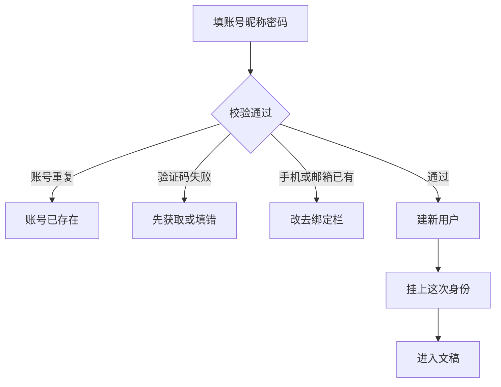

## 改挂

这条身份已经挂在别人身上时，先证明目标账号，再确认「解除原绑定并继续」。身份改挂到目标用户。原用户的文章、角色、部门留在原地，他只是不能再用这一家第三方进来。

目标用户在这家已经绑过另一个账号时，停住并提示先解绑。开了双因素认证的，动态码通过后回到确认页，再点一次才改挂。

**图：把一条身份从原用户改挂到目标用户**

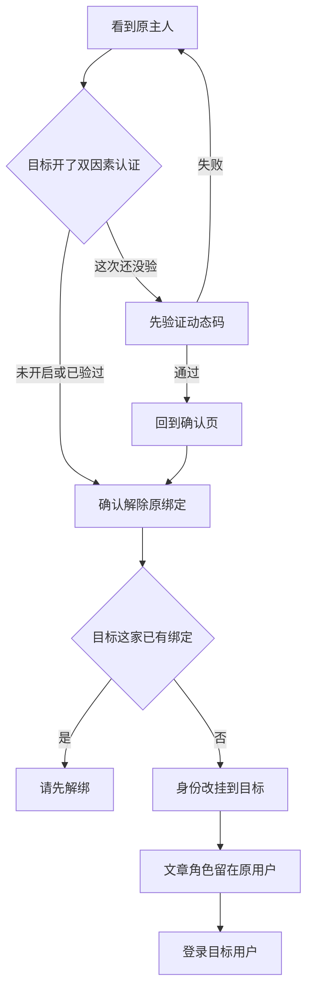

## 登录后再绑定

人已经坐在某个账号里。登录方式页列出还没绑的提供方。当前会话就是这份证明。开了双因素认证时，挂上之前仍要动态码或恢复码。

**图：已登录用户绑定一家新的第三方**

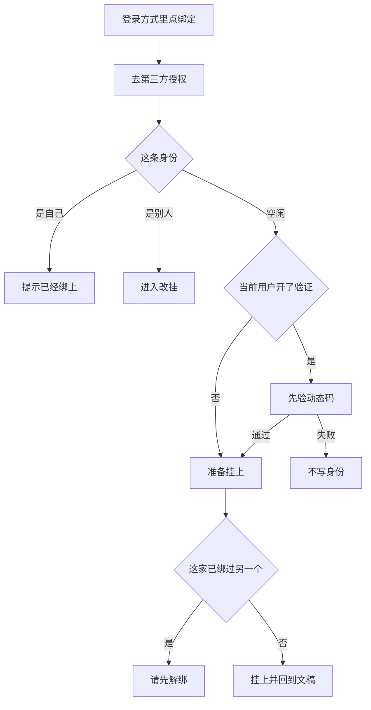

## 解绑

解绑只删掉这一条第三方身份。文章和角色不动。

还能标识这个人的，是这几样：自己设过密码的账号、手机号、邮箱，以及其他第三方。快速创建时系统生成的密码用户不知道，那个账号名不算。解掉之后如果一种都不剩，解绑按钮禁用，并写明这是最后一种，不能解绑。开了双因素认证时，解绑前要动态码或恢复码。

**图：解绑一条第三方**

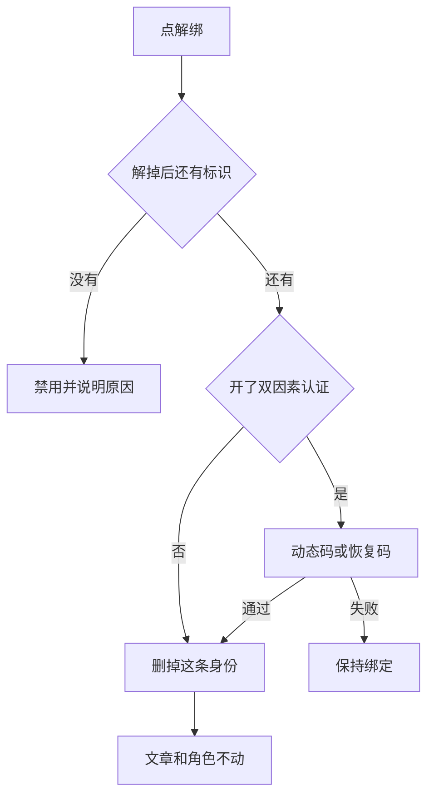

**图：解绑前还要留下的标识**

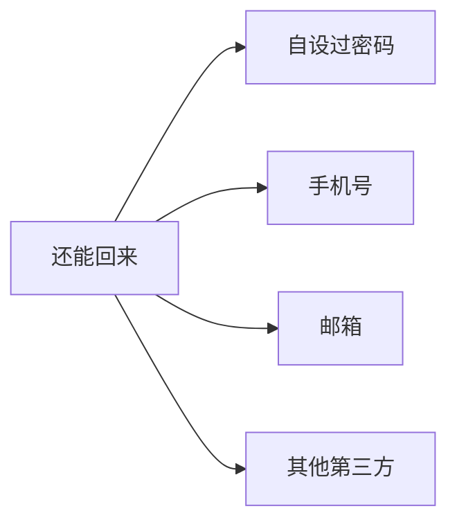

## 双因素认证

开启时展示密钥，用户输入一次动态码后保存，并给出两条恢复码，只显示这一次。关闭时要当前动态码或恢复码，通过后关掉，并清空恢复码。

下面这些门在确定用户之后都要再看一次：密码登录、手机验证码、邮箱验证码、已经绑定的第三方、绑定、改挂、解绑、关闭双因素认证。刚注册的用户还没开启，注册完成可以直接进入。

**图：开启和关闭双因素认证**

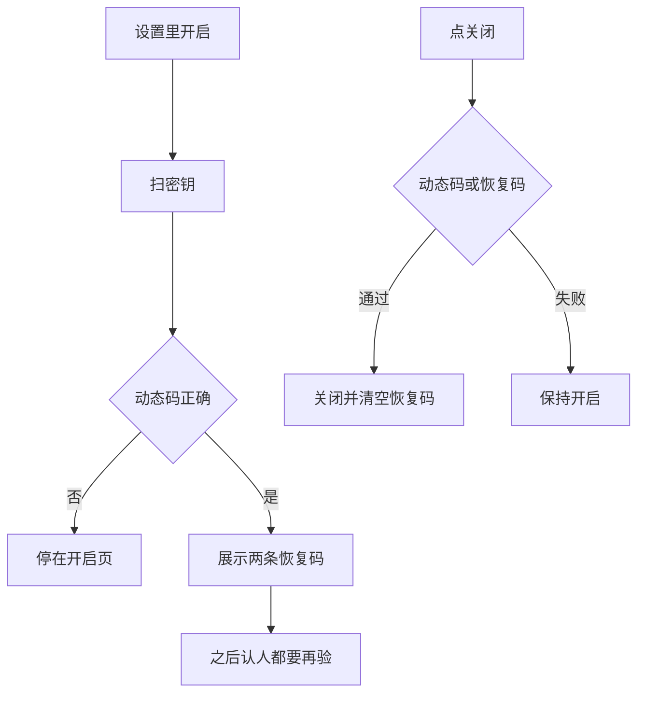

## 授权票据

未完成的第三方结果放在发起授权的浏览器会话里，约 10 分钟，用过即删，不放进可以转发的网址。同一个浏览器只留一张。再点另一家，换成新的，并写明替换了哪一家。取消回到登录页时，这张票据作废。

**图：一张未完成的授权票据**

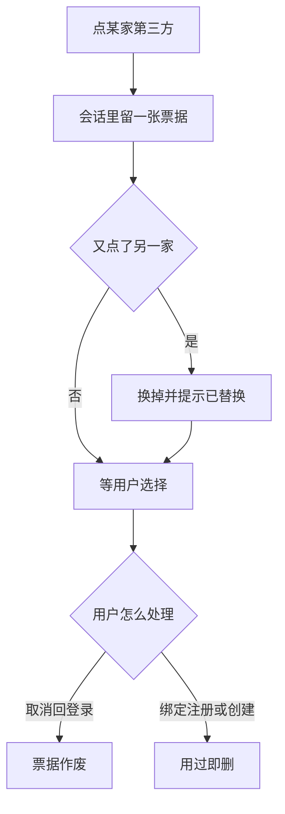
